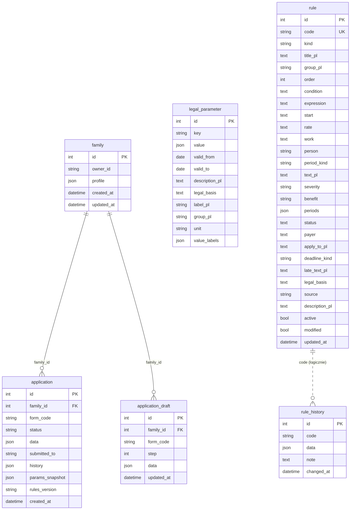
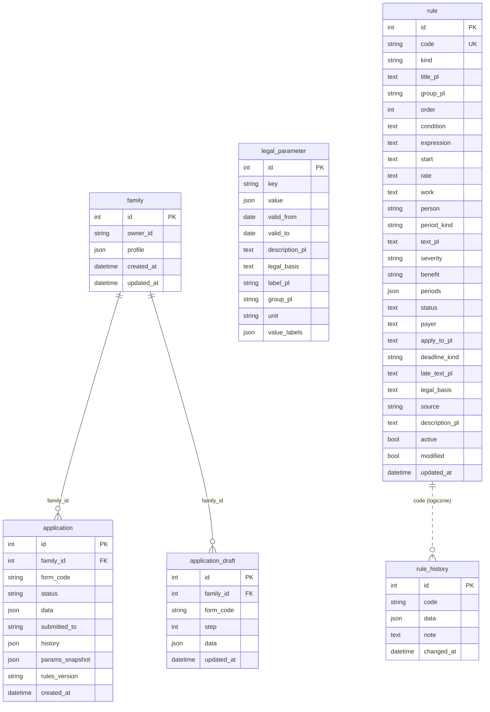

# Schemat bazy danych

Plik generowany przez `scripts/gen_db_schema.py` z modeli SQLAlchemy (`backend/app/models/`).
Produkcyjnie PostgreSQL 16 (kolumny JSON jako `JSONB`), w testach i demo SQLite.
Schemat powstaje z modeli (`create_all` + dodawanie brakujących kolumn), bez migracji.





## Zasady projektu

- **Stan i dane użytkownika** (`family`, `application_draft`, `application`) są powiązane kluczami obcymi
  z `ON DELETE CASCADE`: usunięcie rodziny usuwa jej wersje robocze i wnioski.
- **Konto = rodzina.** `family.owner_id` to identyfikator z logowania mObywatel (mock) albo losowy identyfikator gościa;
  nie ma osobnej tabeli użytkowników, bo tożsamość pochodzi z zewnętrznego systemu.
- **Prawo jest w danych, nie w kodzie.** `legal_parameter` (stałe z okresem obowiązywania) i `rule` (reguły) edytuje
  administrator; `rule_history` przechowuje poprzednie wersje reguł.
- **Złożony wniosek jest niezmienny wobec zmian prawa.** `application.params_snapshot` i `rules_version` utrwalają
  parametry z dnia złożenia, więc zmiana w panelu dotyczy tylko nowych wniosków.
- **Elastyczne dane w JSON.** Profil rodziny, dane formularzy i historia statusów są w kolumnach JSON(B); ich kształt
  waliduje warstwa aplikacji (Pydantic, definicje formularzy), a nie baza.
- **Związki logiczne bez klucza obcego:** `rule_history.code → rule.code` (historia przeżywa usunięcie reguły),
  `application*.form_code → definicje formularzy` (w kodzie: `backend/app/forms/definitions.py`).

## Tabele

### `family`

Rodzina i jej profil – jedno konto (mObywatel) = jedna rodzina. Zapisany stan kalkulatora i kontakty rodziców.

| Kolumna | Typ | Null | Domyślnie | Klucze / uwagi |
|---|---|---|---|---|
| `id` | INTEGER | nie |  | **PK** |
| `owner_id` | VARCHAR(100) | nie |  | identyfikator konta mObywatel (mock) lub gościa |
| `profile` | JSONB | nie |  | JSON: guide_state, calculated_on, contacts (patrz niżej) |
| `created_at` | TIMESTAMP WITH TIME ZONE | nie | `now()` |  |
| `updated_at` | TIMESTAMP WITH TIME ZONE | nie | `now()` |  |

Indeksy i ograniczenia: indeks `ix_family_owner_id` (owner_id).

### `legal_parameter`

Stała prawna (tygodnie, stawki, progi) z okresem obowiązywania – prawo ma wersje w czasie.

| Kolumna | Typ | Null | Domyślnie | Klucze / uwagi |
|---|---|---|---|---|
| `id` | INTEGER | nie |  | **PK** |
| `key` | VARCHAR(100) | nie |  | klucz techniczny, np. maternity_weeks |
| `value` | JSONB | nie |  | JSON: liczba, tekst albo tabela wartości |
| `valid_from` | DATE | nie |  | początek obowiązywania |
| `valid_to` | DATE | tak |  | koniec obowiązywania (NULL = obowiązuje) |
| `description_pl` | TEXT | nie | `''` |  |
| `legal_basis` | TEXT | nie | `''` |  |
| `label_pl` | VARCHAR(200) | nie | `''` |  |
| `group_pl` | VARCHAR(100) | nie | `''` |  |
| `unit` | VARCHAR(20) | nie | `'number'` | jednostka w panelu: number, percent, pln, weeks, days… |
| `value_labels` | JSONB | nie |  |  |

Indeksy i ograniczenia: indeks `ix_legal_parameter_key` (key); ograniczenie unikalności `uq_legal_parameter_key_valid_from` (key, valid_from).

### `rule`

Reguła silnika (wartość, okres, świadczenie, dokument, termin, ryzyko…) edytowana w panelu admina.

| Kolumna | Typ | Null | Domyślnie | Klucze / uwagi |
|---|---|---|---|---|
| `id` | INTEGER | nie |  | **PK** |
| `code` | VARCHAR(80) | nie |  | unikalna; unikalny kod reguły; zależności czytane z wyrażeń |
| `kind` | VARCHAR(20) | nie |  | wartosc / okres / swiadczenie / dokument / termin / ryzyko / informacja / zalozenie / walidacja |
| `title_pl` | TEXT | nie | `''` |  |
| `group_pl` | VARCHAR(100) | nie | `''` |  |
| `order` | INTEGER | nie | `0` |  |
| `condition` | TEXT | tak |  |  |
| `expression` | TEXT | tak |  | wyrażenie w języku reguł |
| `start` | TEXT | tak |  |  |
| `rate` | TEXT | tak |  |  |
| `work` | TEXT | tak |  |  |
| `person` | VARCHAR(200) | tak |  |  |
| `period_kind` | VARCHAR(40) | tak |  |  |
| `text_pl` | TEXT | nie | `''` |  |
| `severity` | VARCHAR(10) | tak |  |  |
| `benefit` | VARCHAR(80) | tak |  |  |
| `periods` | JSONB | nie |  |  |
| `status` | TEXT | tak |  |  |
| `payer` | TEXT | tak |  |  |
| `apply_to_pl` | TEXT | nie | `''` |  |
| `deadline_kind` | VARCHAR(10) | tak |  |  |
| `late_text_pl` | TEXT | nie | `''` | porada po upływie terminu (tylko reguły `termin`) |
| `legal_basis` | TEXT | nie | `''` |  |
| `source` | VARCHAR(20) | nie | `''` |  |
| `description_pl` | TEXT | nie | `''` |  |
| `active` | BOOLEAN | nie | `True` |  |
| `modified` | BOOLEAN | nie | `False` | TRUE – zmieniona w panelu, seed jej nie nadpisuje |
| `updated_at` | TIMESTAMP WITH TIME ZONE | nie | `now()` |  |

Indeksy i ograniczenia: indeks `ix_rule_code` (code).

### `rule_history`

Poprzednie wersje reguł (ślad zmian z panelu administratora).

| Kolumna | Typ | Null | Domyślnie | Klucze / uwagi |
|---|---|---|---|---|
| `id` | INTEGER | nie |  | **PK** |
| `code` | VARCHAR(80) | nie |  | kod reguły (powiązanie logiczne z rule.code, bez klucza obcego) |
| `data` | JSONB | nie |  | JSON: pełna poprzednia wersja reguły |
| `note` | TEXT | nie | `''` |  |
| `changed_at` | TIMESTAMP WITH TIME ZONE | nie | `now()` |  |

Indeksy i ograniczenia: indeks `ix_rule_history_code` (code).

### `application`

Złożony wniosek z historią statusów i migawką parametrów prawnych z dnia złożenia.

| Kolumna | Typ | Null | Domyślnie | Klucze / uwagi |
|---|---|---|---|---|
| `id` | INTEGER | nie |  | **PK** |
| `family_id` | INTEGER | nie |  | **FK** → `family.id` (ON DELETE CASCADE) |
| `form_code` | VARCHAR(50) | nie |  | kod formularza (np. zam, leave_parental) |
| `status` | VARCHAR(30) | nie | `'submitted'` | submitted → in_progress → decided |
| `data` | JSONB | nie |  | JSON: dane wniosku |
| `submitted_to` | VARCHAR(50) | tak |  | adresat: employer / zus / registry |
| `history` | JSONB | nie |  | JSON: lista {at, status, note} |
| `params_snapshot` | JSONB | nie |  | JSON: parametry prawne z dnia złożenia |
| `rules_version` | VARCHAR(40) | tak |  | wersja zestawu reguł (czas ostatniej zmiany) |
| `created_at` | TIMESTAMP WITH TIME ZONE | nie | `now()` |  |

Indeksy i ograniczenia: indeks `ix_application_family_id` (family_id).

### `application_draft`

Wersja robocza wniosku (krok i wpisane dane) – wraca po ponownym zalogowaniu.

| Kolumna | Typ | Null | Domyślnie | Klucze / uwagi |
|---|---|---|---|---|
| `id` | INTEGER | nie |  | **PK** |
| `family_id` | INTEGER | nie |  | **FK** → `family.id` (ON DELETE CASCADE) |
| `form_code` | VARCHAR(50) | nie |  | kod formularza, dla dwóch ról `kod:rola` |
| `step` | INTEGER | nie | `0` | numer kroku, na którym użytkownik skończył |
| `data` | JSONB | nie |  | JSON: wpisane pola formularza |
| `updated_at` | TIMESTAMP WITH TIME ZONE | nie | `now()` |  |

Indeksy i ograniczenia: indeks `ix_application_draft_family_id` (family_id).

### Kształt kolumn JSON

**`family.profile`**
```json
{
  "guide_state": { "form": {...}, "step": 6, "profile": { "child": {...}, "mother": {...}, "father": {...}, "plan": {...} } },
  "calculated_on": "2026-11-18",
  "contacts": {
    "mother": { "first_name": "…", "last_name": "…", "pesel": "…", "address": "…", "employer_name": "…", "employer_address": "…", "place": "…" },
    "father": { "…": "to samo – dane drugiego rodzica wpisane we wniosku" }
  }
}
```

**`application.history`**
```json
[ { "at": "2026-11-03T10:00:00+01:00", "status": "submitted", "note": "Wniosek złożony" },
  { "at": "2026-11-10T10:00:00+01:00", "status": "decided",   "note": "Sprawa rozpatrzona – świadczenie przyznane" } ]
```
