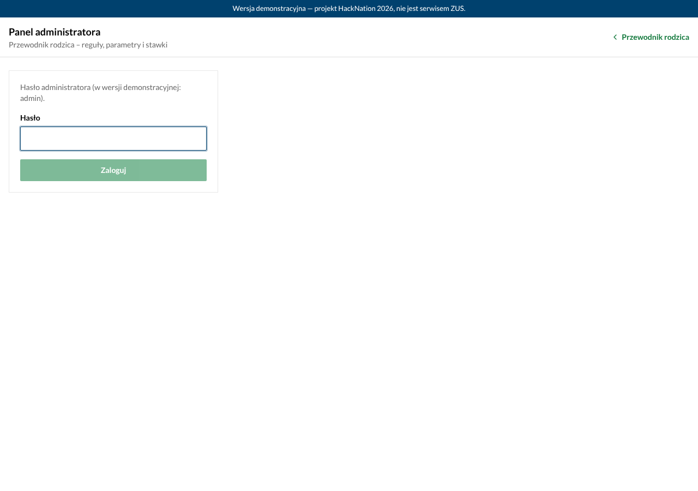
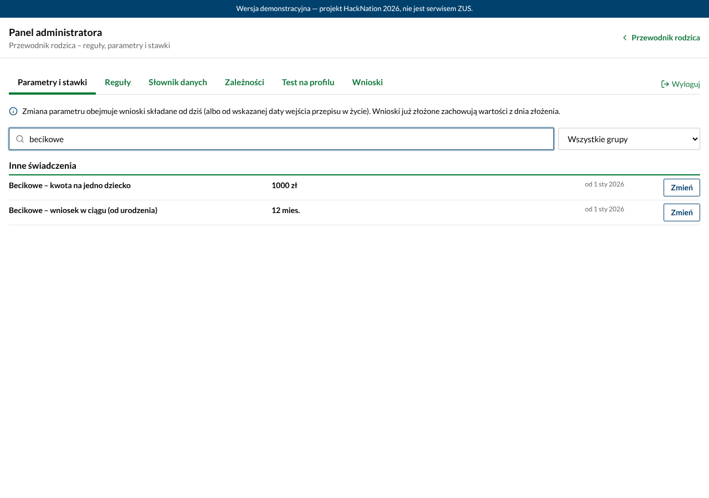
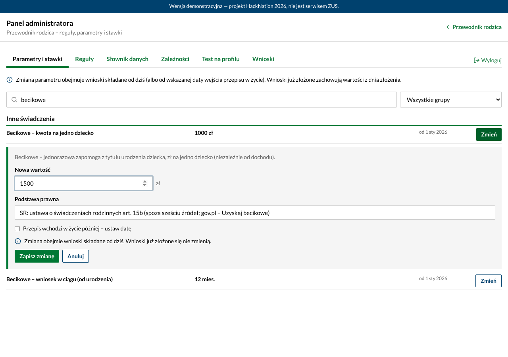
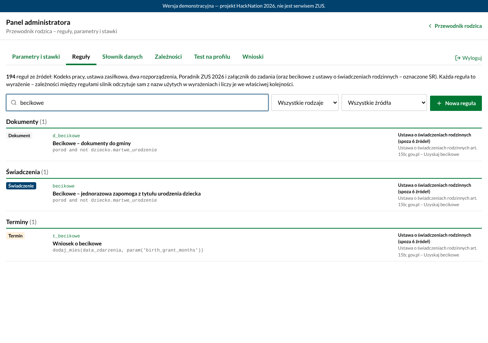
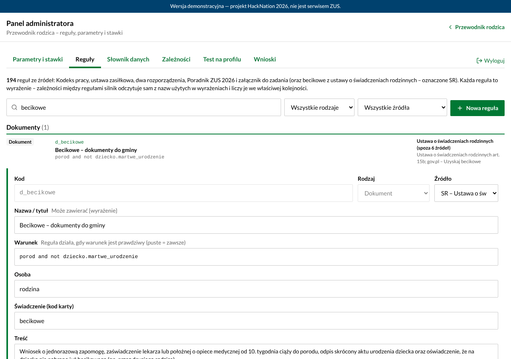
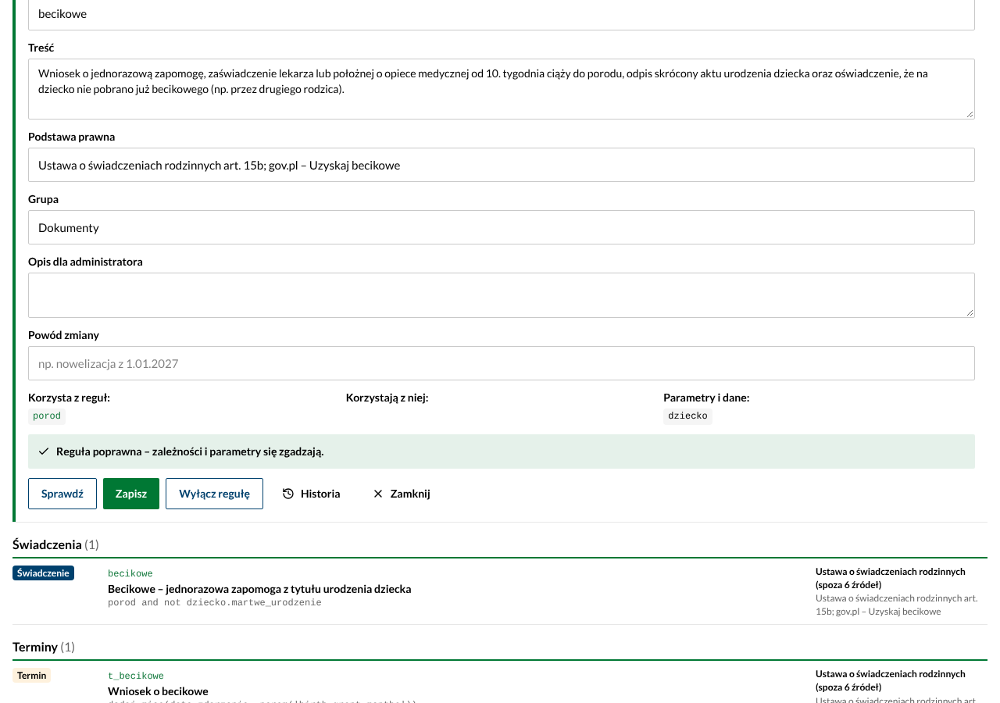
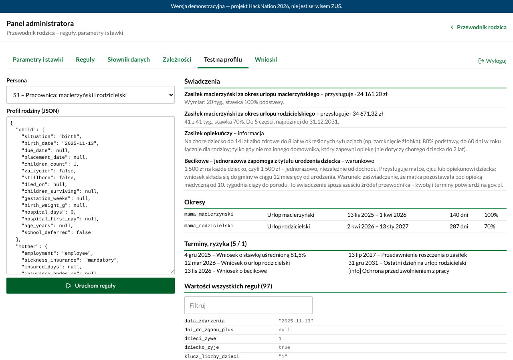
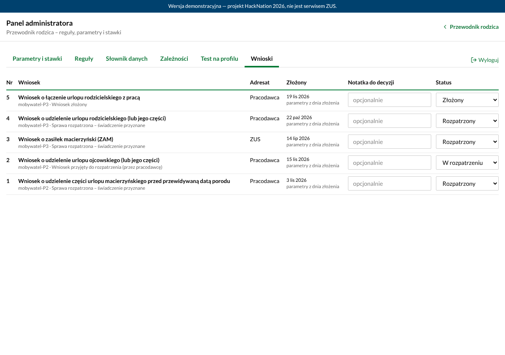

# Instrukcja: panel administratora

Adres: `/admin`, hasło demo: `admin` (zmienna `ADMIN_TOKEN`; poza środowiskiem lokalnym zmień). Panel ma własny, prosty układ.
Link „Przewodnik rodzica” w prawym górnym rogu wraca do aplikacji.

## Do czego służy

W aplikacji **żadna liczba z przepisów ani reguła nie jest wpisana w kod**. Administrator może zmienić:

| Zakładka | Co zmieniasz | Kiedy to potrzebne |
| --- | --- | --- |
| Parametry i stawki | liczby: tygodnie urlopu, stawki %, progi, terminy, kwota becikowego, dzień przelewu | zmiana przepisu |
| Reguły | wyrażenia: kto jest uprawniony, jak liczyć okres, jakie dokumenty i ryzyka pokazać | zmiana interpretacji, nowa reguła |
| Słownik danych | tylko podgląd: dane rodziny, funkcje, parametry, rodzaje reguł | pisząc wyrażenie |
| Zależności | podgląd: z czego korzysta reguła i na co wpływa | przed zmianą reguły |
| Test na profilu | uruchamia wszystkie reguły dla persony albo własnego JSON-a | po każdej zmianie |
| Wnioski | status i notatka złożonych wniosków (obieg po stronie płatnika) | symulacja decyzji |

## 1. Zmiana parametru (np. kwota becikowego)

1. Zakładka **Parametry i stawki**, wpisz w wyszukiwarce np. `becikowe` (można też wybrać grupę).
2. Kliknij **Zmień** przy parametrze.
3. Wpisz nową wartość (procenty wpisuje się jako procenty, tabele – po jednym polu na wiersz).
4. Domyślnie zmiana obowiązuje **od dziś**. Jeśli przepis wejdzie w życie później, zaznacz „Przepis wchodzi w życie później”
   i podaj datę. Wstecz nie można.
5. **Zapisz zmianę**.

Efekt: nowe wyliczenia i **nowe** wnioski używają nowej wartości od razu; wnioski już złożone zachowują wartości z dnia
złożenia. Historia zmian jest pod parametrem – można „cofnąć tę zmianę”.

## 2. Edycja reguły

1. Zakładka **Reguły**. Szukaj po kodzie, nazwie, artykule lub fragmencie wyrażenia; filtruj po rodzaju i źródle.
2. Kliknij regułę, żeby ją otworzyć.

3. Zmień pole (np. warunek albo treść). W tekstach wartości wstawia się w nawiasach klamrowych: `{param('birth_grant_amount')}`.
4. Kliknij **Sprawdź** – silnik sprawdza nazwy, parametry i cykle w całym zestawie reguł.

5. Podaj powód zmiany i **Zapisz**. Dostępne są też: wyłączenie reguły, przywrócenie wersji ze źródeł, usunięcie i historia.
6. Nową regułę dodaje przycisk **Nowa reguła** (kod, rodzaj i źródło).

Rodzaje reguł: `wartosc`, `okres`, `swiadczenie`, `dokument`, `termin`, `ryzyko`, `informacja`, `zalozenie`, `walidacja`.
Reguła **terminu** ma dodatkowe pole z poradą po terminie (co przepadło, co da się jeszcze zrobić).
Pomoc w pisaniu wyrażeń jest w zakładce **Słownik danych**.

## 3. Test na profilu

Wybierz personę (15 scenariuszy testowych) albo wklej własny profil w JSON i kliknij **Uruchom**. Zobaczysz świadczenia,
okresy, terminy i **wartość każdej reguły** – tak sprawdzasz, czy zmiana nie zepsuła innych przypadków.

## 4. Wnioski

Tabela złożonych wniosków (z kont użytkowników): zmień status (złożony / w rozpatrzeniu / rozpatrzony) i dopisz notatkę.
W aplikacji rodzica zmiana jest widoczna od razu na osi czasu, w „Moje urlopy i zasiłki” i na liście wniosków.

## Dobre praktyki

- Najpierw **Zależności** (na co wpłynie zmiana), potem **Sprawdź**, na końcu **Test na profilu**.
- Każda reguła powinna mieć źródło i podstawę prawną. Źródło `SR` (becikowe) jest spoza sześciu źródeł konkursu.
- Dzień przelewu zasiłku (`payout_day`) i kwota becikowego to założenia, nie przepisy z dokumentów zadania.
- Po zmianie modelu danych: `make reset-db`.
