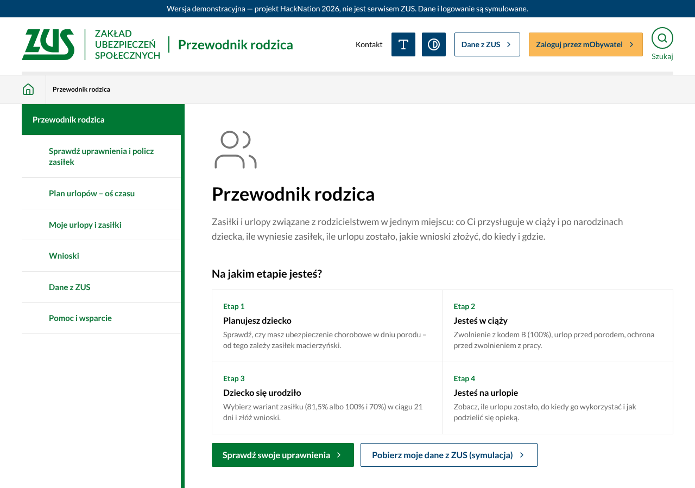
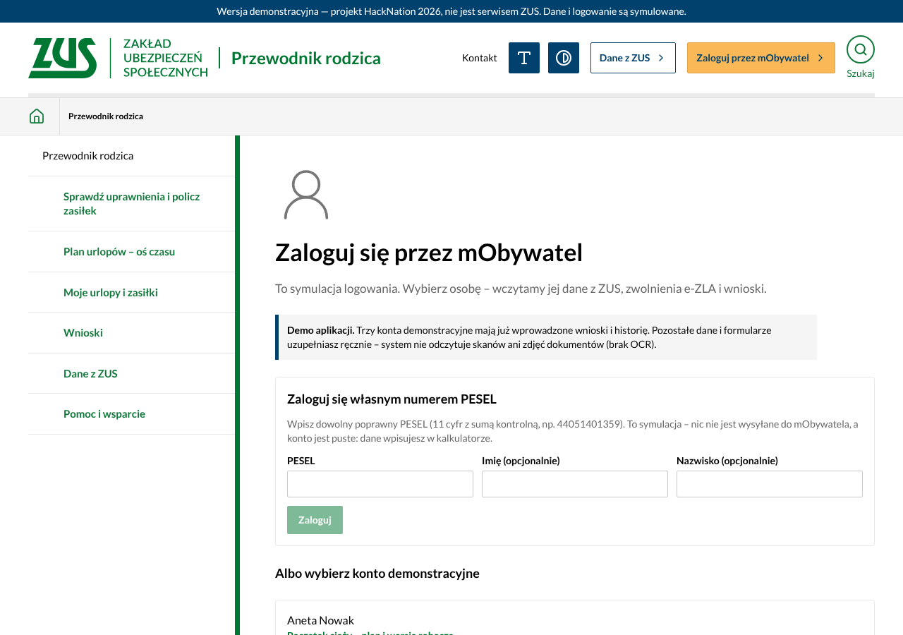
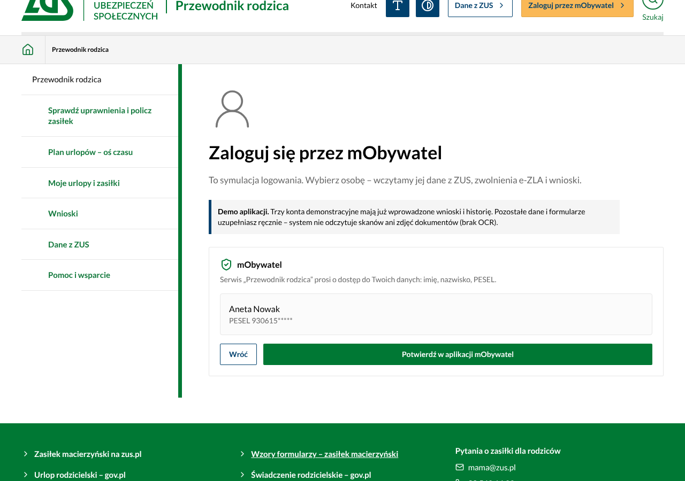
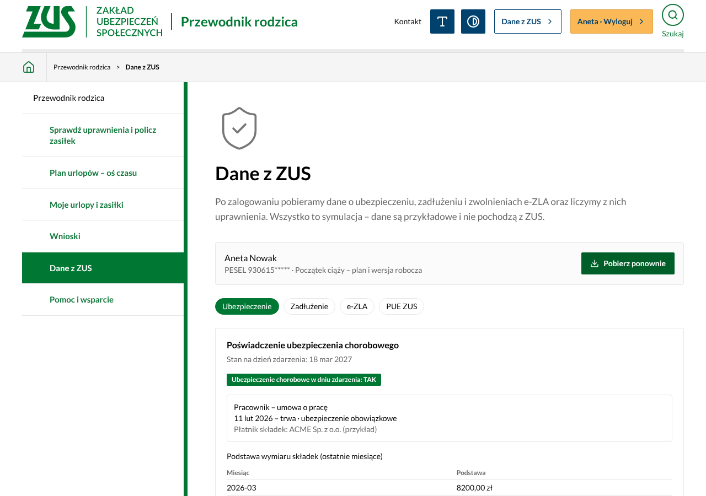
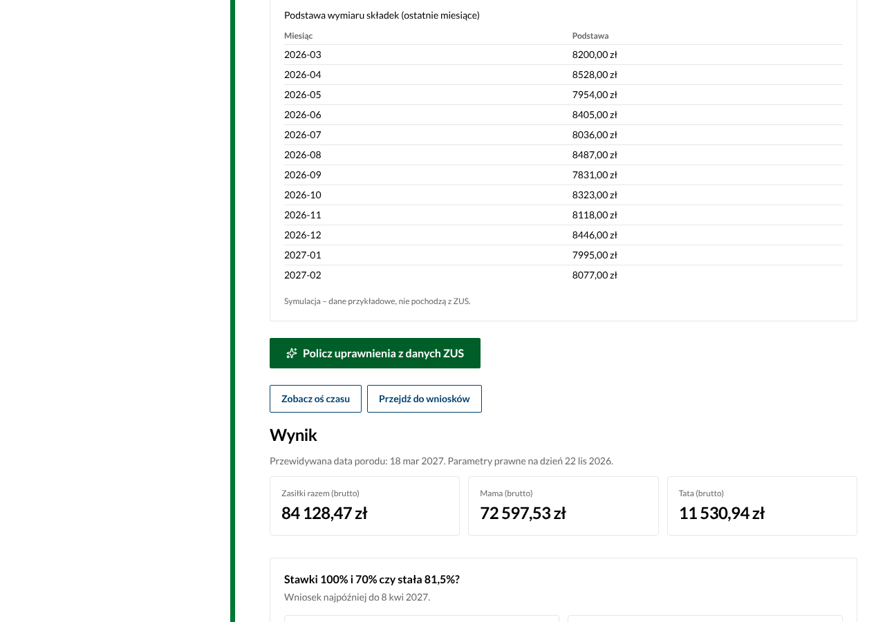
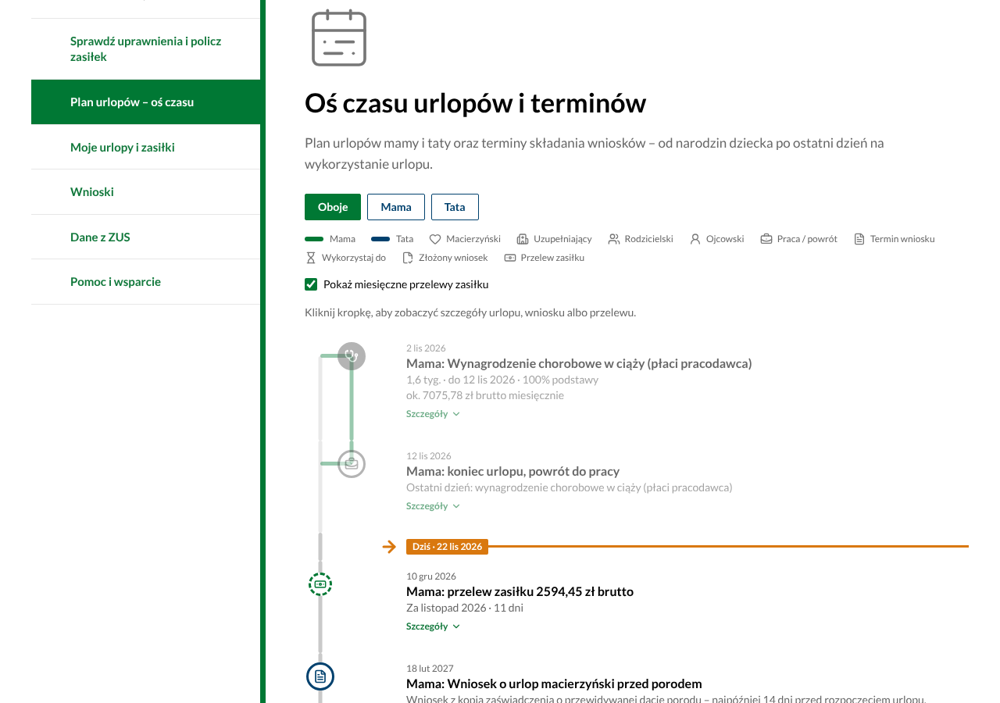
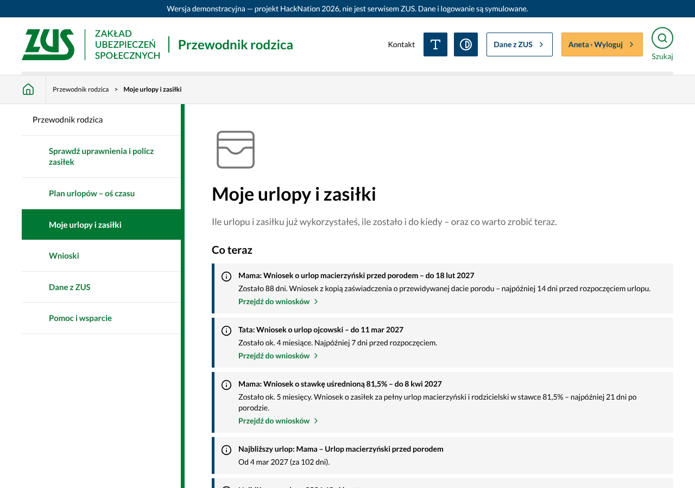
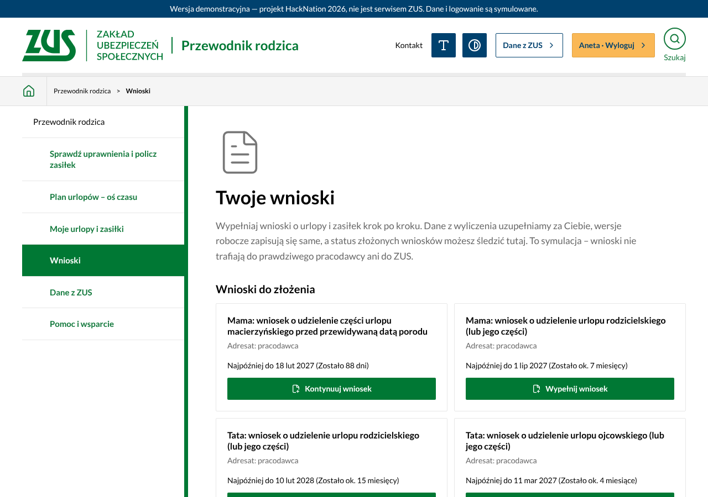

# Instrukcja: jak korzystać z Przewodnika rodzica

Przewodnik pomaga ustalić, jakie urlopy i zasiłki przysługują rodzicom, kiedy trzeba złożyć wnioski i ile pieniędzy
można się spodziewać. To **symulacja** – nic nie jest wysyłane do pracodawcy ani do ZUS.

**Najkrótsza droga (2 minuty):** stopka → „Wejście do dema aplikacji” → wybierz konto demonstracyjne → „Pobierz dane z ZUS”
→ „Policz uprawnienia” → „Zobacz oś czasu”.

## 1. Strona startowa

Na stronie głównej widać ścieżkę w czterech krokach i kafelki narzędzi. Menu po lewej jest takie samo na każdej stronie:

| Pozycja menu | Do czego służy |
| --- | --- |
| Sprawdź uprawnienia i policz zasiłek | kalkulator: odpowiadasz na pytania, dostajesz wynik |
| Plan urlopów – oś czasu | wszystkie urlopy, terminy i przelewy w jednym rzędzie dat |
| Moje urlopy i zasiłki | ile już wykorzystano, ile zostało i do kiedy; co zrobić teraz |
| Wnioski | formularze do wypełnienia i status złożonych |
| Dane z ZUS | symulowane dane o ubezpieczeniu, e-ZLA, pytanie do PUE |
| Pomoc i wsparcie | oficjalne odnośniki i organizacje pomocowe |

## 2. Logowanie (symulacja mObywatela)

Do wyboru są dwie drogi:

- **Własny PESEL** – wpisz dowolny poprawny numer (11 cyfr z sumą kontrolną, np. `44051401359`), opcjonalnie imię
  i nazwisko. Konto jest puste, więc dane rodziny wpisujesz w kalkulatorze.
- **Konto demonstracyjne** – trzy osoby z gotowymi danymi, wersjami roboczymi i wnioskami w różnych statusach
  (początek ciąży, tuż przed porodem, po porodzie). Dobre do pokazu: nic nie trzeba przeklikiwać.

Po wybraniu konta potwierdź logowanie „w aplikacji mObywatel”. W nagłówku pojawi się Twoje imię i „Wyloguj”.

**Bez logowania** można używać kalkulatora i osi czasu oraz zobaczyć **sugestie** wniosków, ale nie można ich wypełniać ani
wysyłać. Wylogowanie czyści dane z przeglądarki; po ponownym zalogowaniu wszystko wraca.

## 3. Dane z ZUS (konta demonstracyjne)

„Pobierz dane z ZUS” pokazuje poświadczenie ubezpieczenia (z podstawą wymiaru z ostatnich miesięcy), zaświadczenie
o zadłużeniu składkowym i e-ZLA. „Policz uprawnienia z danych ZUS” wpisuje te dane do kalkulatora i liczy wynik.
Konto z własnym PESEL-em nie ma danych w ZUS – przejdź od razu do kalkulatora.

> W aplikacji **nie ma OCR**: nie wgrywa się skanów ani zdjęć. Dane pochodzą z symulowanego ZUS albo wpisujesz je ręcznie.

## 4. Kalkulator

`Sprawdź uprawnienia i policz zasiłek` prowadzi przez kroki: sytuacja (ciąża, poród, adopcja, rodzina zastępcza) →
dziecko → rodzina → praca mamy → praca taty → szczególne sytuacje → plan urlopów → wynik. Kroki, które Cię nie
dotyczą, są pomijane. Odpowiedzi zapisują się na koncie.

Wynik zawiera: kwoty brutto (razem, mama, tata), porównanie stawek 100%/70% i 81,5%, karty świadczeń (urlop macierzyński,
rodzicielski, ojcowski, becikowe…), dokumenty do przygotowania, terminy i ryzyka. Kwoty są brutto – podatku nie liczymy.

## 5. Oś czasu

- **Pomarańczowa linia „Dziś”** rozdziela przeszłość (wyszarzone punkty) od przyszłości (normalne kolory).
- Zielona linia to mama, granatowa – tata; ikony w kropkach: poród, urlopy, powrót do pracy, termin wniosku, złożony
  wniosek, przelew zasiłku.
- **Kliknij kropkę**, żeby zobaczyć szczegóły: kwoty, kto płaci, jakie dokumenty, podstawę prawną i – dla terminu – przycisk
  „Wypełnij wniosek”.
- Filtr „Oboje / Mama / Tata” i przełącznik miesięcznych przelewów u góry.
- Złożony wniosek zastępuje punkt terminu, który spełnia. Termin, który minął, ma poradę, co jeszcze da się zrobić.

## 6. Moje urlopy i zasiłki

Jedno miejsce na „co z moimi pieniędzmi i urlopem”:

1. **Co teraz** – zaległe terminy, najbliższe terminy, wnioski w toku, najbliższy urlop i przelew.
2. **Zasiłki w pieniądzach** – ile już wypłacono, ile jeszcze będzie, razem (brutto). Dzień przelewu to założenie planera.
3. **Karty urlopów mamy i taty** – status (zaplanowany / trwa / wykorzystany), pasek postępu, dni wykorzystane i pozostałe,
   data zakończenia oraz ostateczny termin wykorzystania.
4. **Inne świadczenia** – becikowe (wniosek do gminy).

## 7. Wnioski

1. Na górze są **wnioski do złożenia** – przy każdym: do kogo, do kiedy, przycisk „Wypełnij wniosek” (po zalogowaniu).
2. Formularz uzupełnia się danymi z wyniku. Wersja robocza zapisuje się sama.
3. Przed wysłaniem zobaczysz **podgląd dokumentu**, tabelę danych z przyciskiem „Popraw” i oświadczenie o prawdziwości.
4. Po wysłaniu wniosek dostaje status: **złożony → w rozpatrzeniu → rozpatrzony**. W demo kolejny status wybierasz
   przyciskiem.
5. Dane drugiego rodzica z jednego wniosku podpowiadają się w kolejnych.

## Najczęstsze pytania

- **Dlaczego nie mogę wypełnić wniosku?** Nie jesteś zalogowany – zaloguj się (PESEL albo konto demo).
- **Dlaczego wynik jest pusty?** Najpierw przejdź kalkulator albo pobierz dane z ZUS i kliknij „Policz”.
- **Skąd te kwoty?** Z parametrów prawnych na dzień wyliczenia; każda karta wyniku podaje podstawę prawną.
- **Becikowe nie pochodzi z przepisów zadania** – kwotę i terminy trzeba potwierdzić na gov.pl.
- **Gdzie zmienić stawkę albo regułę?** W panelu administratora – zob. [`instrukcja-admina.md`](instrukcja-admina.md).

## Wczytaj przykładową sprawę

Na górze kalkulatora rozwiń „Wczytaj przykładową sprawę”, wybierz jedną z 15 gotowych spraw (S1–S15, oparte na typach spraw z przykładów ZUS), kliknij „Wczytaj i policz”. Kalkulator wypełni się danymi i przejdzie do wyniku; dane można zmienić i policzyć ponownie. Nic nie jest wczytywane z plików – to wybór z listy.
