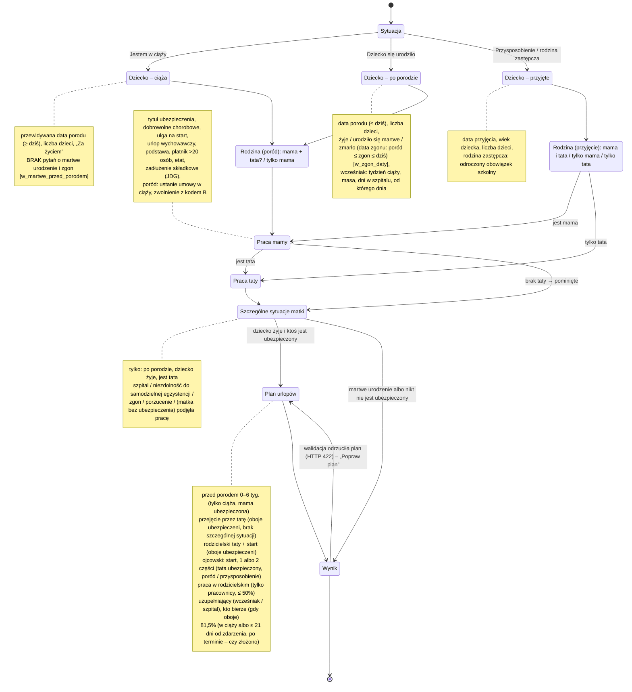
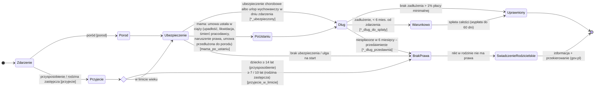
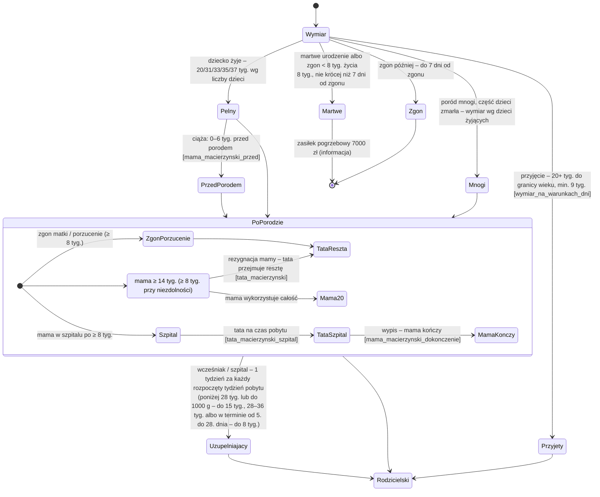
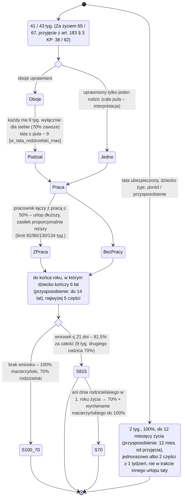
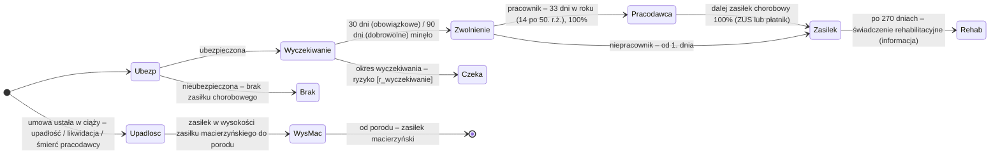

# Maszyna stanów: scenariusze świadczeń rodzicielskich

Dokument opisuje **wszystkie scenariusze**, które przewodnik rozróżnia na podstawie sześciu źródeł
(Kodeks pracy – KP, ustawa zasiłkowa – UZ, rozporządzenie o dokumentach do zasiłków – RZ,
rozporządzenie o wnioskach dotyczących uprawnień rodzicielskich – RW, Poradnik ZUS 2026 – PR,
załącznik o podstawie wymiaru – ZAL). Innych źródeł nie ma.

Diagramy są tylko dokumentacją (wersje PNG: [1-kroki-kalkulatora](diagramy/1-kroki-kalkulatora.png), [2-prawo-do-zasilku](diagramy/2-prawo-do-zasilku.png), [3-urlop-macierzynski](diagramy/3-urlop-macierzynski.png), [4-rodzicielski-ojcowski-stawki](diagramy/4-rodzicielski-ojcowski-stawki.png), [5-ciaza](diagramy/5-ciaza.png)). Działające reguły leżą w bazie (tabela `rule`, seed:
`backend/app/seed/rules/` (pakiet: po jednym pliku na obszar)``), administrator zmienia je w panelu. Kody w nawiasach `[…]` to kody
reguł, które realizują dane przejście.

## 1. Kroki kalkulatora (to, o co pytamy)

Kroki, które w danej sytuacji nie mają sensu, są pomijane. Na przykład bez taty nie ma pytań o
podział urlopu, a martwego urodzenia nie da się wybrać w ciąży.

## 2. Prawo do zasiłku macierzyńskiego (dla każdego rodzica)

Płatnik: ZUS, gdy rodzic sam opłaca składki, płatnik zgłasza ≤ 20 ubezpieczonych albo poród nastąpił
po ustaniu ubezpieczenia; w pozostałych przypadkach pracodawca [`*_platnik`].

## 3. Urlop macierzyński / na warunkach urlopu macierzyńskiego

Matka bez ubezpieczenia (UZ art. 29 ust. 9–10): zasiłek przysługuje tacie po dniu zgonu, porzucenia
albo orzeczenia o niezdolności matki, a gdy matka podjęła pracę (≥ ½ etatu) – na czas jej pracy
[`tata_przejecie_dni`].

## 4. Urlop rodzicielski, ojcowski, stawki

## 5. Ciąża: zwolnienie lekarskie i ustanie umowy

## 6. Terminy i ryzyka (co pilnuje przewodnik)

| Termin | Reguła | Źródło |
|---|---|---|
| Wniosek o urlop macierzyński przed porodem – 14 dni przed | `t_mac_przed` | KP 177 §1¹, RW §2 |
| Wniosek o 81,5% – 21 dni po zdarzeniu | `t_usredniona` | UZ 30a |
| Rezygnacja mamy – 7 dni przed powrotem; wniosek taty – 14 dni | `t_rezygnacja`, `t_tata_macierzynski` | KP 180 §8–9 |
| Urlop uzupełniający – 21 dni przed końcem macierzyńskiego | `t_uzupelniajacy` | KP 180² §4 |
| Urlop rodzicielski – 21 dni przed; łączenie z pracą – 21 dni | `t_rodzicielski_*`, `t_praca_*` | KP 182¹ᵈ, 182¹ᵉ |
| Urlop ojcowski – 7 dni przed; wykorzystać do 12 mies. | `t_ojcowski`, `t_ojcowski_do` | KP 182³ |
| Urlop na warunkach macierzyńskiego – wniosek 7 dni od przyjęcia | `t_na_warunkach` | KP 183 §6 |
| Spłata zadłużenia – 6 miesięcy | `t_dlug_*` | UZ 2a |
| Przedawnienie roszczenia – 6 miesięcy od ostatniego dnia zasiłku | `t_przedawnienie` | UZ 67 |

Pełny katalog reguł z wyrażeniami i podstawą prawną: [reguly.md](reguly.md) (generowany:
`python scripts/gen_rules_doc.py`).

## 7. Interpretacje do potwierdzenia z mentorem

Są skonfigurowane jako reguły, więc można je zmienić w panelu bez wdrożenia:

1. **Cała pula rodzicielskiego dla jedynego uprawnionego rodzica** (`tata_rodzicielski_tyg`,
   `mama_rodzicielski_tyg`). KP 182¹ᵃ §4 mówi o „pracownikach – rodzicach”, UZ 31 ust. 3h
   przewiduje zasiłek rodzicielski taty, gdy matka nie jest ubezpieczona.
2. **Art. 183 §3 KP (9 tygodni / 38 tygodni)** stosujemy, gdy granica wieku dziecka skraca urlop
   na warunkach urlopu macierzyńskiego (`przyjecie_okres_minimalny`).
3. **Termin rodzicielskiego dla rodziny zastępczej** w przypadku z §3 to ukończenie przez dziecko
   14 lat (§4²), w pozostałych przypadkach koniec roku, w którym dziecko kończy 6 lat
   (`rodzicielski_termin`).
4. **Urlop ojcowski przy przysposobieniu**: przepis liczy 12 miesięcy od uprawomocnienia
   postanowienia, a silnik przyjmuje datę przyjęcia dziecka (`ojcowski_termin`).
5. **Kwota świadczenia rodzicielskiego** (podwyższenie z UZ 31 ust. 3a) nie wynika ze źródeł, więc
   parametr `parental_benefit_amount` jest pusty, a reguła `r_podwyzszenie` włączy się po jego
   uzupełnieniu.
6. **Kwoty netto** nie są liczone, bo zaliczka na PIT nie wynika ze źródeł. Wszystkie kwoty są
   brutto.
